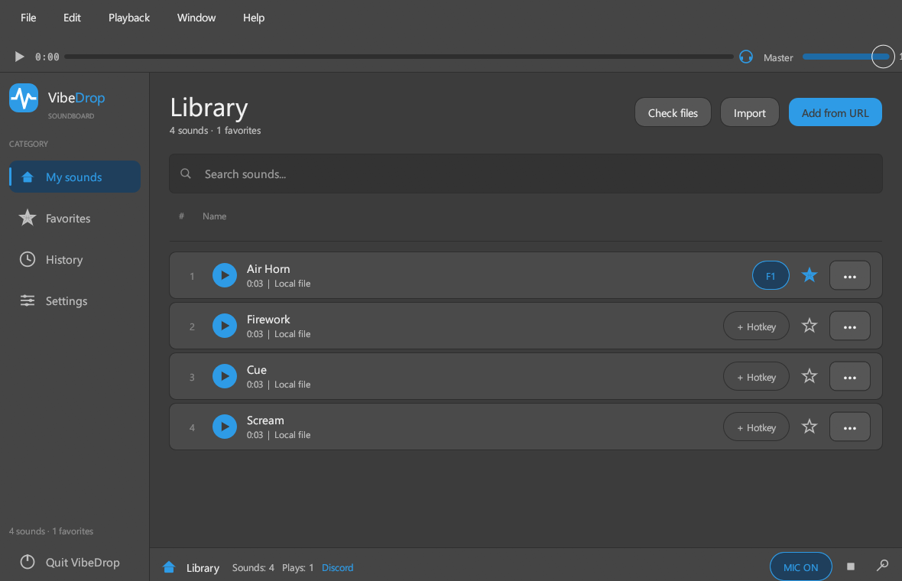
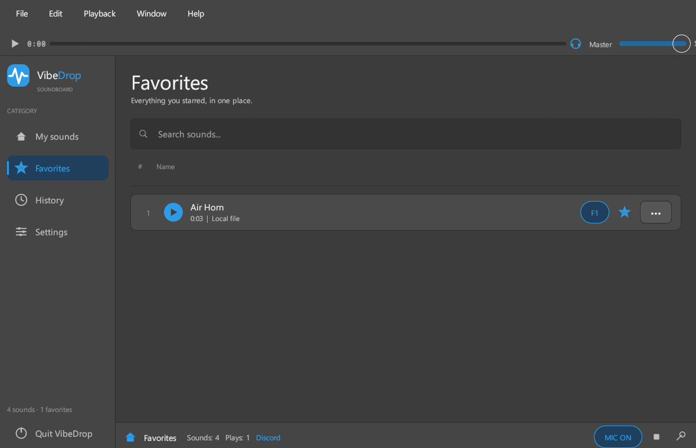
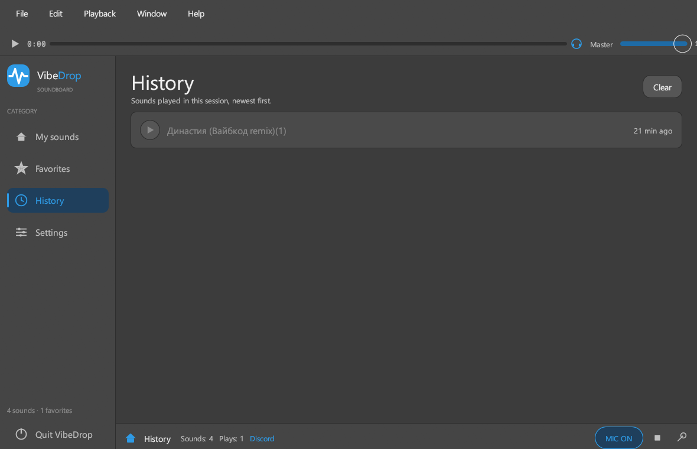
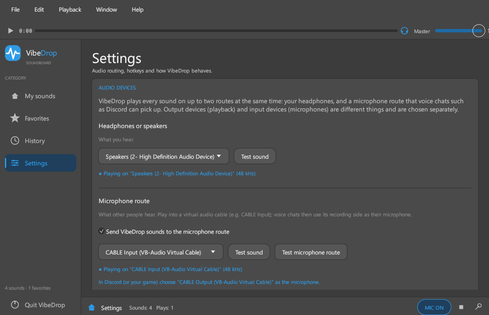

# VibeDrop


[](LICENSE)
[](https://www.rust-lang.org/)
[](#)

Free, open-source soundboard for voice chats, in the spirit of Soundpad: a sound library with
global hotkeys, downloads via `soundpad://` links and a dual output — your headphones hear the
sound, and the voice chat hears it through a second "microphone route". A desktop-first
soundboard interface — compact menu bar, transport strip, category sidebar, sound table and a
status bar — no audio driver bundled or required, Windows, Linux and macOS support.

[Русский перевод](README.ru.md)

## Screenshots

| Library | Favorites |
| --- | --- |
|  |  |

| History | Settings |
| --- | --- |
|  |  |

* License: Apache-2.0 (see [`LICENSE`](LICENSE))
* Status & history: [`PROGRESS.md`](PROGRESS.md), [`CHANGELOG.md`](CHANGELOG.md)
* Audio routing guide: [`docs/AUDIO_ROUTING.md`](docs/AUDIO_ROUTING.md)

## How it works

* **Local playback** always works out of the box — no virtual device is needed. Sounds are
  decoded once, previewed before use, and mixed with a software mixer (limiter + soft clipper,
  independent volume per sound/route, instant stop, retrigger policies).
* **Voice-chat routing** uses your operating system's own facilities:
  * Windows: a virtual audio cable (e.g. free [VB-CABLE](https://vb-audio.com/Cable/)). VibeDrop
    plays into `CABLE Input`; Discord picks `CABLE Output` as its microphone. VibeDrop detects
    installed cables automatically, shows the paired recording side to use, runs a route test
    and warns if no cable is installed. It never downloads or runs installers for you.
  * Linux: PipeWire/PulseAudio virtual sources (see [`docs/AUDIO_ROUTING.md`](docs/AUDIO_ROUTING.md)).
  * VibeDrop ships **no audio driver and never modifies system audio components**. An older
    experimental capture-APO route was evaluated and removed in this release
    (see `CHANGELOG.md`).
* **Your microphone** (optional): enable "Mix my microphone into the microphone route" to send
  your voice and the soundboard over the one device Discord listens to. The physical mic is
  only opened on request, never opened as an output, and the route's own recording side is
  refused as a voice source (feedback-loop protection).

## Free virtual audio cable (VB-CABLE)

Voice chats need a virtual cable so that your microphone picks up the soundboard. VibeDrop
does **not** bundle or download a driver — it only opens the official page of the freeware
product [VB-CABLE by VB-Audio](https://vb-audio.com/Cable/) (menu *Help → Official VB-CABLE
page* or Settings → *Virtual output (FREE)*). Download and install it there (one time, as
administrator), then pick *CABLE Input* as the microphone route in VibeDrop.

VB-CABLE is a separate product of VB-Audio; VibeDrop is an independent project, is not
affiliated with VB-Audio and never redistributes the driver. On Linux, VibeDrop can create a
built-in virtual sink (PipeWire/PulseAudio) without installing anything.

## Features

- Supported audio formats: **WAV**, **MP3** and **MP4/MOV/M4A** (via `symphonia`
  including AAC/ALAC decode). For video files the audio track plays; use
  "Extract audio to WAV" in a sound's ••• menu to save the sound as a separate WAV.
  Sounds are capped at 5 minutes.
- Sound library: add/remove/rename/search/sort sounds, favourites, duplicates detection,
  durations; errors for missing/damaged files stay visible, and the library survives restarts.
- Global hotkeys: per-sound assignment, re-binding/removal, conflict detection, an explicit
  mic-mute hotkey, messages when a combination cannot be registered, released on exit
  (`global-hotkey` crate; on Linux registration depends on the desktop environment — see
  known limitations).
- Play/stop/volume controls, overlap protection, queue-free "tickets" so Stop always beats
  Play, seek by clicking/dragging the progress bar, damaged/audio-file handling that
  reports instead of panicking.
- Sound downloads from approved `soundpad://`/`vibedrop://` links: scheme-validated parsing,
  rejects private IPs and non-HTTP(S) targets, size limits, no auto-download without user
  action, pause/cancel, part-file cleanup, files never executed.
- Interface in **Russian or English** (switch in Settings → Application; the whole UI is one
  language at a time, including error messages from the core modules).
- Settings organized into cards, classic soundboard look (grey surfaces, blue accents,
  compact menu bar, seekable progress bar), toasts instead of panics, keyboard-friendly focus
  handling.
- **Deep customization** (Settings → Appearance): three themes (classic dark / midnight /
  light), any accent colour, corner radius, font size, and per-panel visibility. Changes apply
  immediately, without a restart.
- **Your data is kept**: the library, the settings and the "recently played" list are stored in
  your user profile and survive restarts and updates; Settings → Data folder can export and
  import a backup.
- Discord Rich Presence: the status shows **VibeDrop** while the app is open, and, while a
  sound plays, what you are listening to with the elapsed time (like Spotify).
  To show the app icon next to it, upload `assets/icon.png` in the Discord Developer Portal
  under *Rich Presence → Art Assets* with the name `logo`.
- Virtual output helper: download the free VB-CABLE (Windows) from the official site,
  or create a built-in virtual sink on Linux — no driver ships inside VibeDrop.

## Windows: installation

1. Download the release zip (or build from source below) and unpack it anywhere.
2. Run `vibedrop.exe` (per-user settings live in `%LOCALAPPDATA%\VibeDrop\VibeDrop\data`).
3. Optional: install VB-CABLE yourself if you want voice-chat routing, then follow the
   on-screen "How to set up the microphone route" help or
   [`docs/AUDIO_ROUTING.md`](docs/AUDIO_ROUTING.md).
   Free official download: <https://download.vb-audio.com/Download_CABLE/VBCABLE_Driver_Pack45.zip>
   (or via Settings → VIRTUAL OUTPUT (FREE) → "Download free VB-CABLE", no driver ships
   inside VibeDrop itself).

## Linux: installation

Build from source (see below). Distro packages are prepared but not yet published:
- AUR recipe: [`packaging/arch/PKGBUILD`](packaging/arch/PKGBUILD) (needs a maintainer + real
  checksums after the first tag; see [`packaging/README.md`](packaging/README.md))
- Debian packaging: [`packaging/debian`](packaging/debian) (prepared, never built)
- RPM spec: [`packaging/rpm/vibedrop.spec`](packaging/rpm/vibedrop.spec) (prepared, never built)

Runtime libraries the Linux build needs: ALSA + desktop GUI libraries
(`libasound2`, `libxkbcommon`, `libxkbcommon-x11` on X11, `wayland` for Wayland sessions;
`Ubuntu`: `libasound2-dev libxkbcommon-dev libxkbcommon-x11-dev libx11-dev libwayland-dev`).

## macOS: installation

Download the release tarball (`vibedrop-macos-arm64.tar.gz`, Apple Silicon) and unpack it.
The binary is **not signed/notarized**, so macOS may block the first launch: right-click
`vibedrop` in Finder → **Open**, or run:

```sh
xattr -d com.apple.quarantine vibedrop
```

Then run `./vibedrop`. Global hotkeys on macOS need Accessibility permission for the app
(System Settings → Privacy & Security → Accessibility) — without it the app simply
reports that hotkeys are unavailable. Data lives in `~/Library/Application Support/`.
Soundpad-style `soundpad://` link registration is not wired up on macOS yet.

## Android: status (experimental)

VibeDrop is Android-ready: the app code compiles for `aarch64-linux-android`
(proven by the `Android compile check` workflow) and the UI adapts to phones
(the category sidebar becomes a top strip on narrow screens). The APK itself still
needs the custom entry point: eframe 0.29's `run_native` cannot create the Android
event loop (winit requires an `AndroidApp` from `android_main()`), and that glue must
be tested on a real device. See [`android/README.md`](android/README.md) for the
scaffold, the build commands and exactly what is left. Not available on Android by
design: global hotkeys, `soundpad://` registration and file-picker import; playback,
the library, URL downloads and settings work.

## Building from source

Requirements: Rust 1.80+ (edition 2021, stable toolchain), plus the Linux system packages
listed above on Linux.

```sh
rustup component add rustfmt clippy   # once
cargo fmt --all
cargo test --all-targets
cargo build --release
# Windows: target\release\vibedrop.exe   Linux: target/release/vibedrop
```

CI (`.github/workflows/ci.yml`) runs the same checks on Windows and Ubuntu: `cargo fmt
--check`, `cargo test`, `cargo clippy -D warnings`. No CI step needs a real audio device: the
audio tests are written to pass with no playback/recording hardware present.

## Known limitations

- VibeDrop cannot magically send program audio into the microphone; a virtual device (Windows
  cable, Linux PipeWire loopback) is required for voice-chat routing. Without it VibeDrop
  says so plainly and playback still works.
- Linux GUI/runtime behaviour of VibeDrop itself has **not been verified on the target OS**
  yet (development happens on Windows) — reproducible reports and PRs are very welcome.
- Global hotkeys on Linux depend on the desktop environment (global-hotkey uses the same API
  Valve's games use); some Wayland compositors may not allow them — the app reports
  "Global hotkeys are unavailable" in that case rather than pretending.
- `soundpad://` compatibility covers the link subset validated by tests; third-party sites
  using exotic link shapes are not guaranteed to work, and unsupported actions are rejected.
- The "microphone route" test tone is audible to people in your voice chat (that is how
  it verifies the route); run it with nobody listening.

## Report an issue

Provide your OS, audio setup (which cable), the exact wording of the message you saw, and the
steps to reproduce. Bug templates: `.github/ISSUE_TEMPLATE` (fall back to plain text).

## Acknowledgements

VibeDrop is an independent open-source project (Apache-2.0 license) — it is **not** the
original Soundpad program. Soundpad is a trademark of its respective owner; this project is
not affiliated with or endorsed by that owner. VB-CABLE is a freeware product of VB-Audio;
it is not included in this repository and VB-Audio is not affiliated with this project.
All other trademarks (Discord, PipeWire, PulseAudio, Linux, Windows) belong to their
respective owners.
