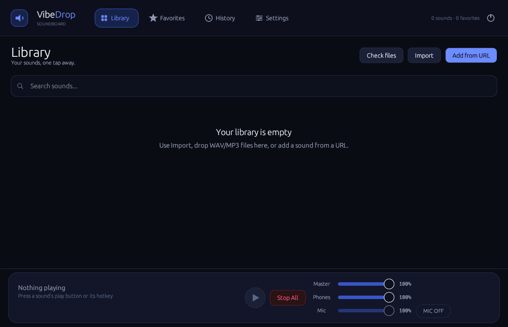
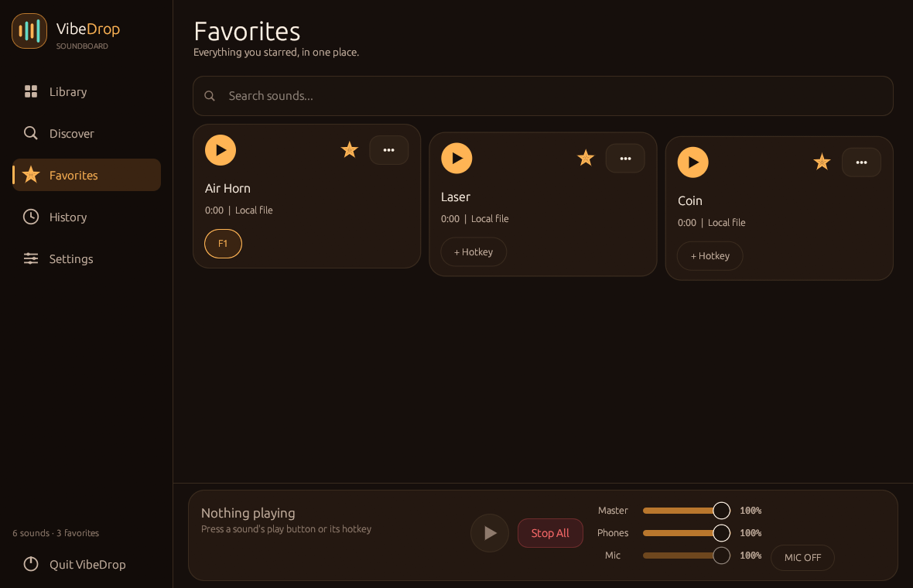
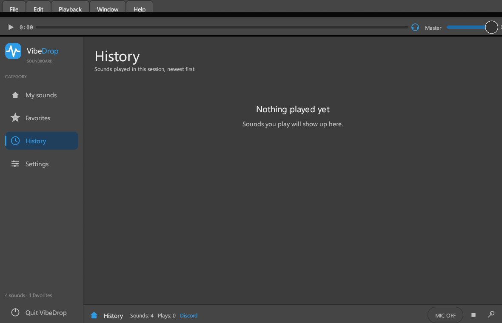
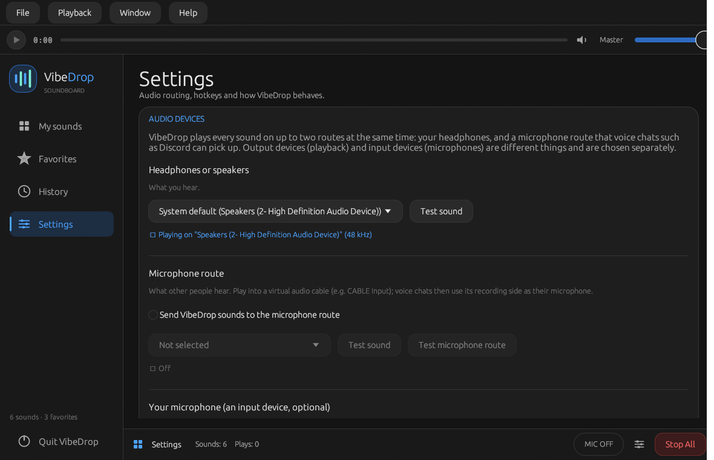

# VibeDrop


[](LICENSE)
[](https://www.rust-lang.org/)
[](#)

[English](README.md)

Бесплатная звуковая доска (саундборд) с открытым исходным кодом для голосовых чатов, в духе
Soundpad: библиотека звуков с глобальными горячими клавишами, загрузка по ссылкам
`soundpad://` и двойной вывод — в наушниках вы слышите звук, а голосовой чат слышит его
через второй «микрофонный маршрут». Настольный интерфейс в стиле саундборда — компактное
меню, транспортная строка, сайдбар категорий, таблица звуков и статус-бар, без встроенного
аудиодрайвера, поддержка Windows, Linux и macOS.

## Скриншоты

| Библиотека | Избранное |
| --- | --- |
|  |  |

| История | Настройки |
| --- | --- |
|  |  |

* Лицензия: Apache-2.0 (см. [`LICENSE`](LICENSE))
* Статус и история: [`PROGRESS.md`](PROGRESS.md), [`CHANGELOG.md`](CHANGELOG.md)
* Руководство по аудиомаршрутам: [`docs/AUDIO_ROUTING.md`](docs/AUDIO_ROUTING.md)
* Руководство по разделу «Музыка»: [`docs/MUSIC.md`](docs/MUSIC.md)

## Как это работает

* **Локальное воспроизведение** всегда работает «из коробки» — виртуальное устройство не
  нужно. Звуки декодируются один раз, предварительно проверяются и микшируются
  программным миксером (лимитер + мягкий клиппинг, независимая громкость на звук/маршрут,
  мгновенная остановка, политики повторного нажатия).
* **Маршрутизация в голосовой чат** использует собственные средства вашей ОС:
  * Windows: виртуальный аудиокабель (например, бесплатный
    [VB-CABLE](https://vb-audio.com/Cable/)). VibeDrop играет в `CABLE Input`; Discord
    выбирает `CABLE Output` в качестве микрофона. VibeDrop автоматически определяет
    установленные кабели, показывает, какую сторону записи использовать, запускает тест
    маршрута и предупреждает, если кабель не установлен. Он никогда не скачивает и не
    запускает установщики за вас.
  * Linux: виртуальные источники PipeWire/PulseAudio (см.
    [`docs/AUDIO_ROUTING.md`](docs/AUDIO_ROUTING.md)).
  * VibeDrop **не поставляет аудиодрайвер и никогда не изменяет системные аудиокомпоненты**.
    Старый экспериментальный маршрут capture-APO был оценён и удалён в этом релизе
    (см. `CHANGELOG.md`).
* **Ваш микрофон** (необязательно): включите «Mix my microphone into the microphone route»,
  чтобы голос и саундборд шли через одно устройство, которое слушает Discord. Физический
  микрофон открывается только по запросу, никогда не открывается как выход, а собственная
  записывающая сторона маршрута отклоняется как источник голоса (защита от обратной связи).

## Бесплатный виртуальный кабель (VB-CABLE)

Для голосовых чатов нужен виртуальный кабель, чтобы микрофон ловил звуки саундборда.
VibeDrop **не встраивает и не скачивает** драйвер — он только открывает официальную
страницу бесплатной программы [VB-CABLE от VB-Audio](https://vb-audio.com/Cable/)
(меню *Справка → Официальная страница VB-CABLE* или Настройки → *Виртуальный выход
(BEСПЛАТНО)*). Скачайте и установите её там (один раз, от имени администратора), затем
укажите *CABLE Input* как маршрут микрофона в VibeDrop.

VB-CABLE — отдельная программа VB-Audio; VibeDrop — независимый проект, не связан с
VB-Audio и никогда не распространяет этот драйвер. В Linux VibeDrop может создать
встроенный виртуальный выход (PipeWire/PulseAudio) вообще без установки.

## Возможности

- Поддерживаемые форматы аудио: **WAV**, **MP3** и **MP4/MOV/M4A** (через `symphonia`,
  включая декодирование AAC/ALAC). Для видеофайлов играет аудиодорожка; через пункт
  «Извлечь звук в WAV» в меню ••• звук можно сохранить отдельным WAV-файлом.
  Звуки ограничены 5 минутами.
- **Раздел «Музыка»**: вставьте ссылку Spotify на трек или альбом — альбом появится
  сгруппированным со всеми треками, а аудио VibeDrop скачает через `yt-dlp`: сначала
  SoundCloud (совпадение принимается, только если длительность отличается от Spotify не
  больше чем на 15 с), затем YouTube с пометкой «official audio». У каждого трека виден
  статус (В очереди / Качается / Готово / Ошибка), альбом играет очередью, а три режима
  повтора (Выкл / Все / Один) выводят звук через те же наушники и маршрут микрофона, что и
  саундпад. Метаданные не требуют аккаунта: по умолчанию читается публичная страница
  Spotify, необязательные Client ID/Secret Web API делают импорт надёжнее. Нужны `yt-dlp`
  и `ffmpeg` — см. [`docs/MUSIC.md`](docs/MUSIC.md).
- Библиотека звуков: добавление/удаление/переименование/поиск/сортировка, избранное,
  обнаружение дубликатов, длительности; ошибки отсутствующих/повреждённых файлов остаются
  видимыми, а библиотека переживает перезапуски.
- Глобальные горячие клавиши: назначение на звук, переназначение/удаление, обнаружение
  конфликтов, отдельная клавиша глушения микрофона, сообщения, когда сочетание
  зарегистрировать не удалось, освобождение при выходе (крейт `global-hotkey`; в Linux
  регистрация зависит от окружения рабочего стола — см. известные ограничения).
- Управление воспроизведением/остановкой/громкостью, защита от наложений, «талоны» без
  очереди, чтобы остановка всегда побеждала запуск, перемотка кликом/перетаскиванием по
  полосе прогресса, обработка повреждённых файлов с сообщением вместо паники.
- Загрузка звуков по одобренным ссылкам `soundpad://`/`vibedrop://`: проверка схемы,
  отклонение приватных IP и не-HTTP(S) целей, лимиты размера, никакой автоматической
  загрузки без действия пользователя, пауза/отмена, очистка частичных файлов, файлы
  никогда не исполняются.
- Интерфейс на **русском или английском** (переключатель в Settings → Application; весь UI
  на одном языке за раз, включая сообщения об ошибках из ядерных модулей).
- Настройки, организованные в карточки, классический стиль саундборда (серые поверхности,
  синие акценты, компактное меню, полоса прогресса с перемоткой), тосты вместо паник,
  удобная работа с клавиатуры.
- **Глубокая кастомизация** (Настройки → Внешний вид): три темы (классическая тёмная /
  полночь / светлая), любой акцентный цвет, скругление углов, размер шрифта и видимость
  отдельных панелей. Изменения применяются сразу, без перезапуска.
- **Данные сохраняются**: библиотека, настройки и список «недавно played» хранятся в профиле
  пользователя и переживают перезапуски и обновления; в разделе «Папка данных» можно
  экспортировать и импортировать резервную копию.
- Rich Presence в Discord: в статусе отображается **VibeDrop**, пока приложение открыто, а
  при воспроизведении — что вы слушаете и сколько секунд (как в Spotify).
  Чтобы рядом показалась иконка приложения, загрузите `assets/icon.png` в Developer Portal
  Discord → *Rich Presence → Art Assets* с именем `logo`.

## Windows: установка

1. Скачайте релизный zip (или соберите из исходников, см. ниже) и распакуйте в любое место.
2. Запустите `vibedrop.exe` (пользовательские настройки лежат в
   `%LOCALAPPDATA%\VibeDrop\VibeDrop\data`).
3. Необязательно: установите VB-CABLE самостоятельно, если нужна маршрутизация в голосовой
   чат, затем следуйте встроенной справке «How to set up the microphone route» или
   [`docs/AUDIO_ROUTING.md`](docs/AUDIO_ROUTING.md).
   Бесплатная официальная загрузка: <https://download.vb-audio.com/Download_CABLE/VBCABLE_Driver_Pack45.zip>
   (или через Settings → VIRTUAL OUTPUT (FREE) → «Download free VB-CABLE»; сам драйвер
   в VibeDrop не входит).

## Linux: установка

Соберите из исходников (см. ниже). Пакеты для дистрибутивов подготовлены, но ещё не
опубликованы:
- Рецепт AUR: [`packaging/arch/PKGBUILD`](packaging/arch/PKGBUILD) (нужен мейнтейнер +
  настоящие контрольные суммы после первого тега; см.
  [`packaging/README.md`](packaging/README.md))
- Debian-упаковка: [`packaging/debian`](packaging/debian) (подготовлена, никогда не собиралась)
- RPM-spec: [`packaging/rpm/vibedrop.spec`](packaging/rpm/vibedrop.spec) (подготовлен, никогда не собирался)

Библиотеки, нужные Linux-сборке в рантайме: ALSA + библиотеки графического интерфейса
рабочего стола (`libasound2`, `libxkbcommon`, `libxkbcommon-x11` на X11, `wayland` для
Wayland-сессий; `Ubuntu`: `libasound2-dev libxkbcommon-dev libxkbcommon-x11-dev
libx11-dev libwayland-dev`).

## macOS: установка

Скачайте релизный tarball (`vibedrop-macos-arm64.tar.gz`, Apple Silicon) и распакуйте его.
Бинарник **не подписан и не нотариализирован**, поэтому macOS может заблокировать первый
запуск: щёлкните по `vibedrop` в Finder правой кнопкой → **Открыть**, или выполните:

```sh
xattr -d com.apple.quarantine vibedrop
```

Затем запустите `./vibedrop`. Горячие клавиши на macOS требуют разрешения на доступность
для приложения (System Settings → Privacy & Security → Accessibility) — без него
приложение просто сообщит, что хоткеи недоступны. Данные лежат в
`~/Library/Application Support/`. Регистрация ссылок `soundpad://` на macOS пока не настроена.

## Android: статус (экспериментально)

VibeDrop готов к Android на уровне кода: приложение компилируется под
`aarch64-linux-android` (доказано workflow «Android compile check»), а интерфейс
адаптируется под телефоны (сайдбар превращается в верхнюю полосу на узких экранах).
Сам APK пока требует кастомную точку входа: `eframe::run_native` (0.29) не может создать
Android-событийный цикл (winit требует `AndroidApp` из `android_main()`), и это нужно
реализовывать и тестировать на реальном устройстве. Подробности, scaffold и команды
упаковки — в [`android/README.md`](android/README.md). На Android недоступны по дизайну:
глобальные хоткеи, регистрация `soundpad://` и импорт через файловый диалог; воспроизводятся
библиотека, загрузки по ссылкам и настройки.

## Сборка из исходников

Требования: Rust 1.80+ (edition 2021, stable toolchain), плюс перечисленные выше системные
пакеты Linux в Linux.

```sh
rustup component add rustfmt clippy   # один раз
cargo fmt --all
cargo test --all-targets
cargo build --release
# Windows: target\release\vibedrop.exe   Linux: target/release/vibedrop
```

CI (`.github/workflows/ci.yml`) запускает те же проверки на Windows и Ubuntu: `cargo fmt
--check`, `cargo test`, `cargo clippy -D warnings`. Ни один шаг CI не требует реального
аудиоустройства: аудио-тесты написаны так, чтобы проходить без оборудования для
воспроизведения/записи.

## Известные ограничения

- VibeDrop не может волшебным образом направить программный звук в микрофон; для
  маршрутизации в голосовой чат нужно виртуальное устройство (кабель Windows, PipeWire
  loopback в Linux). Без него VibeDrop прямо говорит об этом, а воспроизведение всё равно
  работает.
- Поведение GUI/рантайма VibeDrop в Linux **пока не проверено на целевой ОС** (разработка
  идёт на Windows) — воспроизводимые сообщения об ошибках и PR очень приветствуются.
- Глобальные горячие клавиши в Linux зависят от окружения рабочего стола (global-hotkey
  использует тот же API, что и игры Valve); некоторые композиторы Wayland могут их не
  разрешать — в таком случае приложение сообщает «Global hotkeys are unavailable», а не
  делает вид, что всё работает.
- Совместимость `soundpad://` охватывает подмножество ссылок, покрытое тестами;
  сторонние сайты с экзотическими формами ссылок не гарантированы, неподдерживаемые
  действия отклоняются.
- Тестовый тон «микрофонного маршрута» слышен людям в вашем голосовом чате (именно так он
  проверяет маршрут); запускайте его, когда никто не слушает.

## Сообщение об ошибке

Укажите ОС, аудионастройку (какой кабель), точную формулировку увиденного сообщения и шаги
для воспроизведения. Шаблоны багов: `.github/ISSUE_TEMPLATE` (если не сработают — просто
текстом).

## Благодарности

VibeDrop — независимый проект с открытым исходным кодом (лицензия Apache-2.0), это **не**
оригинальная программа Soundpad. Soundpad — товарный знак соответствующего
правообладателя; данный проект не аффилирован с ним и не одобрен им. VB-CABLE —
бесплатная программа VB-Audio; она не входит в этот репозиторий, и VB-Audio не
аффилирована с данным проектом. Все прочие товарные знаки (Discord, PipeWire,
PulseAudio, Linux, Windows) принадлежат их правообладателям.

## Участники

Спасибо всем, кто помогает VibeDrop — полный список в
[`.github/CONTRIBUTORS.md`](.github/CONTRIBUTORS.md):

- [@kolokolbobo-ship-it](https://github.com/kolokolbobo-ship-it)
